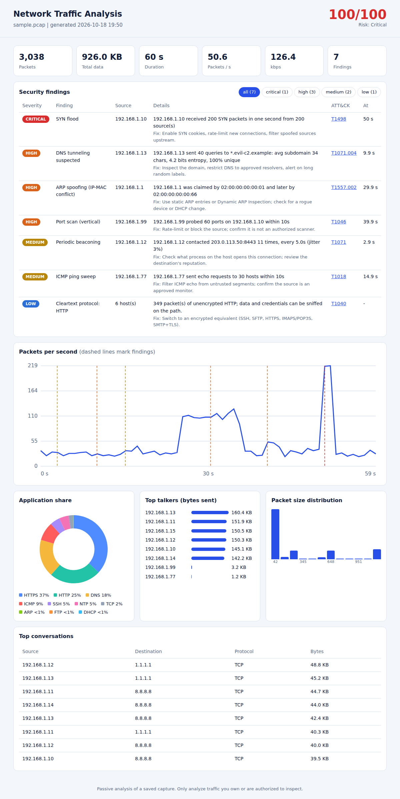

# Network Traffic Analyzer

Pure-Python PCAP analyzer with a **threat-detection engine** and an **interactive HTML dashboard**.
No Scapy, dpkt or pyshark: the Ethernet / IPv4 / IPv6 / TCP / UDP / ICMP / ARP / DNS parsing is written from scratch with `struct`.



## Features
- Protocol breakdown, packet and size statistics, top talkers, top conversations, traffic timeline
- **Security findings** with severity, MITRE ATT&CK technique ID and a suggested fix
- **Self-contained dashboard** (`dashboard.html`): works offline, no libraries; findings are marked on the timeline and can be filtered by severity
- Risk score (0-100) for the whole capture
- CSV exports (`findings.csv`, `timeline.csv`, `protocols.csv`) and an optional matplotlib `report.png`

## Detections (passive, read-only)
| Detection | Method | ATT&CK |
|---|---|---|
| Port scan (vertical) | many unique ports on one host in a 10 s window, from SYN-without-ACK packets | T1046 |
| Host sweep (horizontal) | one port probed across many hosts in a 10 s window | T1046 |
| SYN flood | SYN rate to one host per second, with number of sources | T1498 |
| ARP spoofing | one IP claimed by more than one MAC address | T1557.002 |
| DNS tunneling | many unique, long, high-entropy subdomains under one domain | T1071.004 |
| Periodic beaconing | connections to one destination at near-constant intervals (low jitter) | T1071 |
| ICMP ping sweep | echo requests to many hosts in a short window | T1018 |
| Cleartext protocols | established Telnet / FTP / HTTP / POP3 / IMAP / SMTP sessions | T1040 |

Thresholds live in `CFG` at the top of `detectors.py`.

## Quick start
```bash
python analyzer.py sample sample.pcap          # lab traffic with simulated attacks (writes a file only)
python analyzer.py analyze sample.pcap --open  # report + dashboard in output/
python analyzer.py analyze capture.pcap        # your own capture (tcpdump -w capture.pcap)
```
Optional: `pip install matplotlib` for `report.png` (use `--no-png` to skip it).

## Limitations
- Classic `.pcap` only (not pcapng); Ethernet and raw-IP link types
- Heuristics, not signatures: expect false positives (for example DHCP changes can look like ARP conflicts; busy servers can look like floods). Tune `CFG`.
- DNS domain grouping uses the last two labels, so `co.uk`-style suffixes are approximated

## Ethics
This tool only reads saved captures and never sends packets. The sample generator writes a `.pcap` file only. Analyze traffic you own or are authorized to inspect.

MIT License
